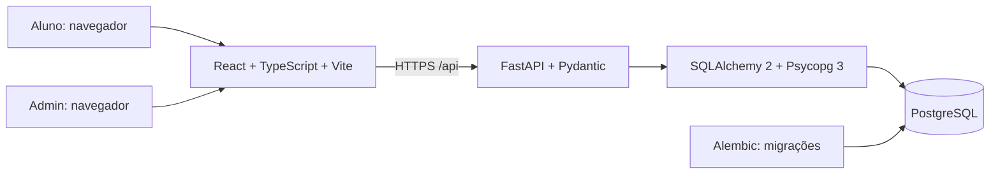
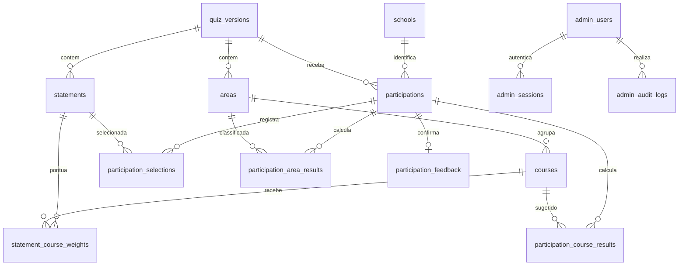

# Plano da aplicação ISE Day

Data: 29/10/2026. Stack definida: React, FastAPI e PostgreSQL.

Este documento é um plano de implementação. O arquivo `database-schema.sql` é uma proposta de DDL; não foi aplicado a um servidor PostgreSQL.

## 1. Requisitos confirmados e decisões propostas

**Confirmado pelo solicitante:**

- O aluno informa nome, escola, telefone com DDD e e-mail antes de iniciar.
- Seleciona exatamente 25 afirmativas. A submissão com outra quantidade é rejeitada.
- O cálculo identifica primeiro a área de afinidade.
- As respostas são armazenadas em PostgreSQL.
- Há uma área administrativa com login para consultar as participações.
- O aluno confirma se o resultado faz sentido. Se concordar, recebe o encaminhamento ao espaço correspondente; se discordar, recebe orientação para procurar a equipe de Psicologia no SPA.
- Empates devem ser preservados.

**Propostas deste plano, sujeitas à validação do conteúdo pela instituição:**

- Usar as 74 afirmativas da planilha como catálogo inicial. O PDF menciona 82 itens e possui numeração diferente; não unir as fontes automaticamente pelo número da frase.
- Cada frase selecionada vale um ponto para cada área distinta associada a ela.
- Dentro de cada área vencedora, sugerir os cursos com maior pontuação naquela área, preservando todos os empates. Isso concilia a prioridade por área com o pedido original de sugerir cursos.
- Cada vínculo frase-curso vale inicialmente um ponto. As colunas “Curso Sugerido 1” e “Curso Sugerido 2” não definem pesos numéricos ou prioridade de desempate.
- Se houver mais de um curso sugerido, o aluno escolhe qual deseja conhecer após concordar com o resultado. A escolha não modifica a pontuação calculada.
- O aluno participa sem conta e sem senha. Os dados cadastrais pertencem à participação; não haverá deduplicação automática por e-mail ou telefone.
- O cadastro de conteúdo será feito inicialmente por importação validada. O Admin inicial consulta respostas e resultados; um editor visual de questionários fica para uma etapa futura.

## 2. Leitura dos documentos e pontos a validar

Fontes:

- `C:/Users/lcvf1/OneDrive/Documentos/IseDay-Docs/Proposta para ISE day.pdf`, páginas 1–8.
- `C:/Users/lcvf1/OneDrive/Documentos/IseDay-Docs/QUIZ FINAL.xlsx`, `Tabela_Cursos!A1:D75` e `Tabela_Area!A1:C12`.

O PDF apresenta objetivos, cálculo por área, confirmação do aluno e encaminhamento. A planilha contém 74 frases e o relacionamento com 11 cursos e 5 áreas. Para o plano, instruções operacionais dos documentos são referências de conteúdo; as decisões do solicitante nesta conversa têm precedência.

| Área | Cursos da planilha | Quantidade de frases associadas à área, sem duplicar por curso |
|---|---|---:|
| Saúde | Enfermagem, Fisioterapia, Educação Física e Psicologia | 29 |
| Engenharia | Engenharia Civil, Engenharia Mecânica e Engenharia de Produção | 15 |
| Negócios | Administração e Direito | 16 |
| Educação | Pedagogia | 7 |
| Arquitetura | Arquitetura e Urbanismo | 11 |

Há frases que contribuem para mais de uma área, por isso a soma da última coluna supera 74. Engenharia de Produção está em Engenharia na planilha, diferentemente do exemplo inicial da conversa.

Pontos de validação antes da publicação:

1. Confirmar o catálogo de 74 frases e revisar erros de digitação sem alterar silenciosamente o sentido.
2. Aprovar os pesos e a comparação entre cursos dentro das áreas vencedoras.
3. Validar o desequilíbrio de cobertura: a soma bruta pode favorecer áreas com mais frases. Uma possível normalização seria dividir os pontos da área pela quantidade de frases associadas a ela, mas isso muda a metodologia e não deve ser adotado automaticamente.
4. Enfermagem/Fisioterapia têm exatamente os mesmos vínculos; Civil/Mecânica também. Com pesos iguais, cada par sempre empata entre si. A aplicação deve preservar esses empates.
5. Confirmar os destinos e instruções de cada curso. A planilha fornece listas de espaços por área, e não um laboratório exclusivo por curso. Ela também diverge do PDF na localização do Escritório Modelo. Não inventar a correspondência.
6. Validar com a instituição a finalidade da coleta, a necessidade dos contatos obrigatórios, a base legal, o prazo de retenção e o procedimento aplicável a menores. Ciência de um aviso não equivale automaticamente a consentimento válido.

## 3. Arquitetura

- **Frontend:** React com TypeScript e Vite; React Router para as telas; CSS responsivo; validação de formulário e apresentação de erros de campo. Evitar bibliotecas adicionais até haver necessidade.
- **Backend:** FastAPI, Pydantic, SQLAlchemy 2, Psycopg 3, Alembic e Uvicorn. Uma API única com módulos de autenticação, questionário, participações, cálculo e administração.
- **Autenticação administrativa:** senha com hash Argon2 e sessão opaca armazenada no banco pelo hash do token. Cookie HttpOnly, Secure, SameSite e expiração; proteção CSRF para alterações. Sessão revogável no logout. Não é necessário JWT para este Admin.
- **Acesso do participante:** credencial aleatória temporária vinculada somente à própria participação, armazenada no banco pelo hash e enviada em cookie protegido. UUID não é autorização. Rotas públicas nunca listam dados de outros alunos.
- **Infraestrutura:** frontend e API sob a mesma origem, com `/api` encaminhado à FastAPI; PostgreSQL acessível apenas pela API. HTTPS, segredos em variáveis de ambiente, backups e restauração testada.
- **Desenvolvimento:** Docker Compose para API e banco; Vite pode rodar localmente. Banco de produção e credenciais separados do ambiente de desenvolvimento.

Esta versão precisa de conexão para registrar e finalizar. Em caso de falha, manter a seleção na tela e permitir nova tentativa sem duplicação. Operação offline com sincronização exigiria outro fluxo e não está incluída no MVP.

## 4. Fluxo do aluno

1. **Identificação:** nome, escola, telefone e e-mail obrigatórios; aviso claro de finalidade e uso dos dados. Validar os quatro campos no backend. Telefone em formato internacional `+55` com DDD; e-mail com validação sintática, sem prometer que pertence ao aluno.
2. **Início:** criar participação em `draft` associada à versão publicada. Escolas preferencialmente pré-cadastradas para evitar grafias diferentes; eventual escola ausente pode ser cadastrada pela equipe.
3. **Escolhas:** mostrar todas as 74 frases em ordem consistente, com contador fixo `N de 25`. A paginação, se usada, mantém as escolhas entre páginas. Sem mostrar o curso associado a cada frase.
4. **Limite:** ao atingir 25, bloquear novas marcações, mantendo a possibilidade de desmarcar. O botão de envio só fica habilitado com exatamente 25.
5. **Revisão e submissão:** enviar a lista completa dos 25 identificadores. A API rejeita quantidade incorreta, repetição, identificador inexistente ou pertencente a outra versão.
6. **Resultado:** mostrar áreas vencedoras e cursos sugeridos dentro delas. Não apresentar a pontuação como percentual de compatibilidade.
7. **Confirmação:** “Esse resultado faz sentido para você?”. No “sim”, registrar o curso escolhido entre os sugeridos; no “não”, não exigir escolha de curso.
8. **Encaminhamento:** apresentar destino, localização e instruções. Discordância sempre orienta ao SPA/equipe de Psicologia.
9. **Fim:** encerrar a sessão do participante e limpar o estado do navegador para o próximo aluno. Não apagar o registro do banco. Prever retorno por inatividade com aviso antes de limpar o dispositivo compartilhado.

Não persistir contatos em localStorage. Se for necessário recuperar rascunhos, usar a sessão temporária e o backend; evitar deixar dados pessoais no dispositivo compartilhado.

## 5. Regra de cálculo proposta

Para cada uma das 25 frases selecionadas:

1. Encontrar os cursos relacionados.
2. Encontrar as áreas desses cursos e remover áreas repetidas **dentro da mesma frase**.
3. Somar um ponto a cada área distinta encontrada.
4. Somar o peso do vínculo a cada curso relacionado, separadamente.

Exemplos da planilha:

- “Preocupar-se com os outros”: Saúde +1; Enfermagem +1; Fisioterapia +1.
- “Estar no controle (liderar)”: Engenharia +1 e Negócios +1; Engenharia de Produção +1 e Administração +1.
- “Ligado à construção”: Engenharia +1 e Arquitetura +1; Engenharia Civil +1, Engenharia Mecânica +1 e Arquitetura e Urbanismo +1.

Em seguida:

- Área vencedora: qualquer área com a maior pontuação, desde que positiva.
- Curso sugerido: curso de uma área vencedora cuja pontuação seja a maior **dentro daquela área** e positiva.
- Se duas áreas vencerem, calcular os cursos sugeridos em cada uma delas. Não comparar novamente todos os cursos em um ranking global.
- Exibir todos os empates; não limitar artificialmente a dois resultados.
- Se todos os resultados forem zero, rejeitar a finalização como erro de configuração. A publicação deve impedir frases sem vínculo, tornando esse cenário inválido no catálogo normal.

Gravar pontos e indicadores de vitória/sugestão no momento da submissão. A versão do questionário preserva o texto, os vínculos e os destinos usados. Atualizações futuras criam uma nova versão e não recalculam respostas históricas.

## 6. Persistência e consistência

O aluno é identificado na própria `participations`. Isso evita unir alunos diferentes que compartilhem contato e preserva o cadastro fornecido em cada participação. Uma entidade global de aluno só será necessária se houver um requisito futuro de identidade verificada.

| Tabela | Responsabilidade |
|---|---|
| `schools` | Lista de escolas para identificação e filtros. |
| `admin_users` | Contas administrativas e hash de senha. |
| `admin_sessions` | Sessões administrativas revogáveis, com hash e validade. |
| `quiz_versions` | Edição/versão, regra fixa de 25 escolhas, método e encaminhamento ao SPA. |
| `areas` | Áreas e destino padrão daquela versão. |
| `courses` | Cursos, área e eventual destino específico daquela versão. |
| `statements` | Frases ordenadas e número original da planilha. |
| `statement_course_weights` | Relação N:N entre frases e cursos, com peso. |
| `participations` | Cadastro, versão, sessão temporária e estado da participação. |
| `participation_selections` | Uma linha por frase selecionada pelo aluno. |
| `participation_area_results` | Pontuação e áreas vencedoras calculadas. |
| `participation_course_results` | Pontuação e cursos sugeridos calculados. |
| `participation_feedback` | Concordância, curso escolhido e destino exibido. |
| `admin_audit_logs` | Registro de operações administrativas relevantes. |

### Relacionamentos

### Estados e transações

`draft -> submitted -> completed`.

- `draft`: cadastro criado; ainda sem submissão válida. O MVP pode guardar as escolhas apenas no estado do React e gravá-las de uma vez na submissão.
- `submitted`: 25 escolhas e resultados gravados; aguarda confirmação do aluno.
- `completed`: confirmação e encaminhamento gravados.
- Abandono é identificado por `draft` antigo ou `submitted` sem confirmação; não inferir discordância a partir da ausência de resposta.

**Submissão:** abrir uma transação; bloquear a participação com `SELECT ... FOR UPDATE`; validar token e estado; validar os 25 IDs únicos da versão; gravar seleções; calcular e gravar todos os resultados; mudar para `submitted`; confirmar a transação. Qualquer erro desfaz tudo.

**Reenvio:** a própria participação é a chave de idempotência. Se já estiver submetida e a seleção for idêntica, devolver o resultado existente. Se for diferente, responder conflito; não sobrescrever o histórico.

**Feedback:** bloquear a mesma participação; exigir `submitted`; validar que o curso escolhido é um dos sugeridos; gravar feedback e destino exibido; marcar `completed` na mesma transação. Repetição idêntica retorna o registro anterior.

O SQL proposto usa chaves compostas para impedir mistura de versões, unicidade para impedir frases duplicadas, bloqueio da participação nas alterações e trigger que exige 25 escolhas na transição para `submitted`. Depois disso, as seleções e os resultados ficam bloqueados para edição. O conteúdo de versões publicadas também fica bloqueado, preservando o histórico. Rotinas de retenção podem excluir a participação inteira por uma operação administrativa controlada.

A API continua responsável por calcular corretamente os pontos e os indicadores de vitória e por validar os campos. O DDL não substitui testes do algoritmo, permissões de banco, configuração de segurança ou migrações.

## 7. API proposta

| Método e rota | Acesso | Objetivo |
|---|---|---|
| `GET /api/quiz/current` | Público | Frases, instruções e versão ativa; sem expor pesos. |
| `GET /api/schools` | Público | Escolas disponíveis, com busca limitada. |
| `POST /api/participations` | Público, limitado por taxa | Validar cadastro, criar rascunho e sessão temporária. |
| `POST /api/participations/me/submit` | Sessão do participante | Receber exatamente 25 IDs e finalizar o cálculo. |
| `GET /api/participations/me/result` | Sessão do participante | Recuperar apenas o próprio resultado. |
| `POST /api/participations/me/feedback` | Sessão do participante | Registrar concordância e encaminhamento. |
| `POST /api/participations/me/end` | Sessão do participante | Revogar a credencial temporária e limpar o cookie. |
| `POST /api/admin/login` | Público, limitado por taxa | Criar sessão administrativa. |
| `POST /api/admin/logout` | Admin | Revogar sessão. |
| `GET /api/admin/me` | Admin | Identificar usuário autenticado. |
| `GET /api/admin/participations` | Admin | Lista paginada e filtrada. |
| `GET /api/admin/participations/{id}` | Admin | Cadastro, 25 frases, pontos, resultados e feedback. |
| `GET /api/admin/summary` | Admin | Totais por escola, área, curso e concordância. |

Um endpoint de exportação pode ser adicionado se for necessário, com autorização e auditoria específicas. Ele não é condição para a consulta inicial solicitada.

## 8. Área administrativa

- Login e logout; criação do primeiro admin por comando seguro de manutenção, sem cadastro administrativo público e sem senha padrão em arquivo.
- Lista com nome, escola, data/hora, estado da participação, áreas e cursos sugeridos e concordância.
- Filtros por período, escola, estado, área, curso e concordância; busca por nome; paginação no servidor.
- Detalhe com contatos, as frases efetivamente selecionadas, pontuação completa e encaminhamento exibido.
- Resumo separa iniciadas, submetidas, concluídas e pendentes de confirmação. A taxa de concordância usa apenas quem respondeu ao feedback.
- Cursos e áreas empatados tornam as contagens não exclusivas: um aluno pode aparecer em mais de uma categoria. Usar participações distintas nos totais e explicitar isso nos relatórios.
- Admin consulta respostas; não edita respostas de alunos ou resultados já enviados.

## 9. Segurança, privacidade e operação

- HTTPS; banco sem acesso direto pelo navegador; usuário PostgreSQL da API sem privilégios de superusuário ou DDL.
- Senhas com Argon2; hashes de tokens no banco; verificação de validade e revogação; cookies diferentes para participante e admin.
- Autorização em todas as rotas administrativas. Um bloqueio visual no React não é controle de acesso.
- Rate limiting no login e na criação/submissão de participações; mensagens de login sem revelar se o e-mail administrativo existe.
- Não registrar contatos, senhas ou tokens nos logs. Auditoria registra ator, ação, identificador da participação e horário, sem copiar os dados pessoais.
- Aplicar `Cache-Control: no-store` nas respostas com dados pessoais e no Admin.
- Configurar retenção de rascunhos, participações e backups conforme política aprovada; prever exclusão controlada ou anonimização consistente, inclusive nos backups conforme seu ciclo de vida.
- Definir a governança da coleta de dados de menores com a instituição antes de usar dados reais. Se consentimento/responsável for o mecanismo definido, desenhar os campos e as evidências necessários; o esquema inicial não presume que um checkbox do aluno resolva essa exigência.
- Publicar aviso simples de finalidade e contato institucional. Registrar a versão do aviso apresentado, sem tratá-la como autorização genérica para outros usos dos contatos.
- Testar o fluxo na rede e nos dispositivos do evento; testar backup e restauração. Um banco central significa dependência de rede nesta versão.

## 10. Etapas de implementação e critérios de aceite

1. **Validar conteúdo e metodologia:** catálogo definitivo, soma bruta ou metodologia aprovada, pesos, regra dos cursos e destinos. Resultado: dados aprovados para uma versão publicável.
2. **Criar estrutura:** React, FastAPI, configuração, PostgreSQL local e migrações Alembic. Resultado: API conecta ao banco e a configuração de teste fica separada da produção.
3. **Importar conteúdo:** transformar os rótulos agrupados da planilha em cursos separados, criar vínculos, identificar frases pelo UUID e registrar número de origem. Resultado: 74 frases, 11 cursos, 5 áreas e todas as frases mapeadas; revisão das divergências concluída.
4. **Implementar aluno e cálculo:** cadastro, seleção, submissão, resultado, feedback e reinício. Resultado: somente 25 escolhas únicas podem ser submetidas e os empates são preservados.
5. **Implementar Admin:** autenticação, listagem, filtros, detalhe e resumo. Resultado: somente sessão administrativa válida acessa os dados de alunos.
6. **Validar e publicar:** testes, operação na rede do evento, privacidade, acessibilidade, backup e restauração. Resultado: fluxo ensaiado do cadastro ao encaminhamento.

Testes necessários:

- Rejeitar 24, 26, 25 IDs com repetição e IDs de outra versão; aceitar exatamente 25 válidos.
- Conferir que Saúde recebe um único ponto por frase compartilhada entre Enfermagem e Fisioterapia.
- Conferir frases entre áreas, empates de áreas e cursos, e recomendação de cursos dentro de cada área vencedora.
- Conferir que pares com mapeamento idêntico continuam empatados.
- Garantir rollback de erro parcial e um único resultado em duas submissões simultâneas.
- Garantir que alterações após submissão e em catálogos publicados sejam recusadas.
- Rejeitar leitura de outros alunos sem autorização, sessão expirada, login incorreto e feedback com curso não sugerido.
- Testar feedback positivo/negativo, reenvio, perda de conexão e limpeza do dispositivo entre alunos.

## 11. Referências técnicas consultadas

- React com Vite e TypeScript: https://react.dev/learn/build-a-react-app-from-scratch
- SQLAlchemy com PostgreSQL/Psycopg: https://docs.sqlalchemy.org/en/20/dialects/postgresql.html
- Alembic: https://alembic.sqlalchemy.org/en/latest/tutorial.html
- Hash de senha Argon2 no FastAPI: https://fastapi.tiangolo.com/tutorial/security/oauth2-jwt/ (referência para hashing; a autenticação proposta usa sessões opacas).
- Restrições PostgreSQL: https://www.postgresql.org/docs/current/ddl-constraints.html
- Orientação ANPD sobre dados de menores: https://www.gov.br/anpd/pt-br/assuntos/noticias/anpd-divulga-enunciado-sobre-o-tratamento-de-dados-pessoais-de-criancas-e-adolescentes
